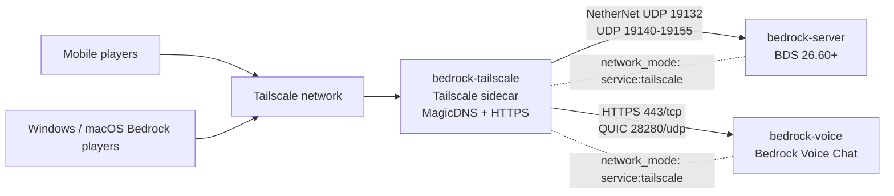

# Private Minecraft Bedrock + Tailscale + Proximity Voice Chat

A reproducible Apple Silicon Mac deployment for a private Minecraft Bedrock Dedicated Server (`26.60+`) with optional 3D proximity voice chat. It uses OrbStack, Docker Compose, an in-container Tailscale sidecar, and free Tailscale-issued HTTPS certificates. No router port forwarding is required.

## Features

- Official Bedrock Dedicated Server through `itzg/minecraft-bedrock-server`.
- NetherNet transport for BDS `1.26.60+` with UDP `19132` and `19140-19155`.
- Bedrock Voice Chat over HTTPS `443/tcp` and QUIC `28280/udp`.
- Three containers sharing one Tailscale network namespace: `bedrock-tailscale`, `bedrock-voice`, and `bedrock-server`.
- Optional voice profile: set `COMPOSE_PROFILES=voice` for voice chat, or leave it empty for Minecraft only.
- Zero-dependency macOS helper scripts: built-in Bash utilities, `curl`, `unzip`, and `/usr/bin/perl` with `JSON::PP`.
- `.mcworld` or copied-world setup, nested BVC `.mcpack` extraction, `26.60` Script API compatibility, and drag-and-drop pack installation.

## Architecture



The `extra_hosts` entry on `tailscale` maps `${TS_DOMAIN}` to `127.0.0.1`. It is intentional: the Tailscale container disables DNS acceptance, while BDS still needs to resolve the voice server's HTTPS name locally with valid TLS SNI.

## Quickstart

### 1. Install prerequisites

On an Apple Silicon Mac, install [OrbStack](https://orbstack.dev/) and start its Docker engine. Docker Compose is included with the Docker CLI supplied by OrbStack. No Homebrew, `jq`, or Xcode Command Line Tools are required by the repository scripts.

Clone this repository somewhere separate from any existing live server:

```bash
git clone https://github.com/YOUR_GITHUB_USERNAME/minecraft-bedrock-tailscale.git
cd minecraft-bedrock-tailscale
cp .env.example .env
```

Edit `.env` and set a real Tailscale machine name/domain. The domain must be the MagicDNS name of this machine, for example `minecraft-bedrock.your-tailnet.ts.net`; do not publish that value.

Keep `COMPOSE_PROFILES=voice` for voice chat. To run Minecraft without BVC, set `COMPOSE_PROFILES=` and skip the voice setup steps.

### 2. Authenticate the Tailscale sidecar

Start only the sidecar first:

```bash
docker compose up -d tailscale
set -a; . .env; set +a
read -r -s TS_AUTHKEY
printf '\n'
docker exec bedrock-tailscale tailscale up \
  --accept-dns=false \
  --auth-key="$TS_AUTHKEY" \
  --hostname="$TS_HOSTNAME"
unset TS_AUTHKEY
```

Create a reusable, one-time auth key in the Tailscale Admin Console if desired. The key is never committed. If the sidecar already has persistent state, it may already be authenticated; verify with:

```bash
docker exec bedrock-tailscale tailscale status
```

In Tailscale Admin DNS, enable MagicDNS and HTTPS certificates. The `setup-voice.sh` script can detect the machine's current DNS name and update the ignored `.env` value.

If friends will use free personal Tailscale accounts, share this machine from the Admin Console. Add the following to the existing Tailscale policy file, merging with existing rules rather than replacing them:

```json
{
  "grants": [
    {
      "src": ["autogroup:member", "autogroup:shared"],
      "dst": ["*"],
      "ip": ["*"]
    }
  ]
}
```

The `autogroup:shared` entry is important for Machine Sharing. Use the narrowest policy appropriate for your tailnet if you already maintain more restrictive ACLs.

### 3. Start Minecraft

For a Minecraft-only server:

```bash
docker compose up -d
```

For the default voice-enabled stack:

```bash
docker compose --profile voice up -d
```

Connect from Bedrock using **Play → Servers → Add Server**, with the Tailscale hostname from `.env` and port `19132`. Do not use the automatically discovered LAN World entry; it can advertise a Docker bridge or IPv6 endpoint.

### 4. Configure Bedrock Voice Chat and the Beta APIs world

Create or export a Bedrock world on a client with **Experiments → Beta APIs** enabled. Then pass either the `.mcworld` file or the copied Bedrock world folder:

```bash
./scripts/setup-voice.sh "YourXboxGamertag" "/path/to/Voice-World.mcworld"
# or
./scripts/setup-voice.sh "YourXboxGamertag" "/path/to/copied-bedrock-world"
```

The setup script:

1. Detects the sidecar's MagicDNS name and obtains a 90-day Tailscale HTTPS certificate.
2. Extracts both nested `.mcpack` files from the BVC `.mcaddon`.
3. Installs the behavior/resource packs and patches the `26.60` Script API manifest compatibility versions.
4. Copies the world into `data/worlds/$LEVEL_NAME`, enables the required server modules, writes the local BVC token, and generates an initial login code.

Install the official Bedrock Voice Chat companion app on each player device, enter `https://YOUR_MACHINE.YOUR_TAILNET.ts.net`, and use the generated login code. The Minecraft server and voice app both need Tailscale connectivity.

### 5. Install addons and texture packs

Drag a pack from Finder onto Terminal, or pass one or more paths directly:

```bash
./scripts/install-pack.sh "/path/to/addon.mcaddon"
./scripts/install-pack.sh "/path/to/texture.mcpack" "/path/to/another-pack.zip"
```

The installer accepts `.mcpack`, `.mcaddon`, `.zip`, or an unpacked folder, detects the Bedrock manifest using `JSON::PP`, updates the active world's pack lists, and restarts BDS.

## Administration

Run commands from the repository directory:

```bash
./scripts/manage.sh start
./scripts/manage.sh stop
./scripts/manage.sh restart
./scripts/manage.sh logs
./scripts/manage.sh logs bedrock-server
./scripts/manage.sh cmd "say Server restart in five minutes"
./scripts/manage.sh op "YourXboxGamertag"
./scripts/manage.sh awake
./scripts/manage.sh backup
./scripts/manage.sh renew-cert
```

`backup` stops BDS only while it archives local runtime data into ignored `backups/`. `renew-cert` refreshes the Tailscale-issued certificate and restarts only BVC.

## Repository safety

`.env`, Tailscale state, BVC TLS/SQLite state, Bedrock `data/`, backups, world archives, and the raw `conversation-export.md` are ignored. The raw export is deliberately not part of the public repository because it contains personal tailnet identifiers and live addresses.

See [docs/PLAYER-GUIDE.md](docs/PLAYER-GUIDE.md) for a friend-facing onboarding guide and [docs/TROUBLESHOOTING.md](docs/TROUBLESHOOTING.md) for the solved failure modes.

